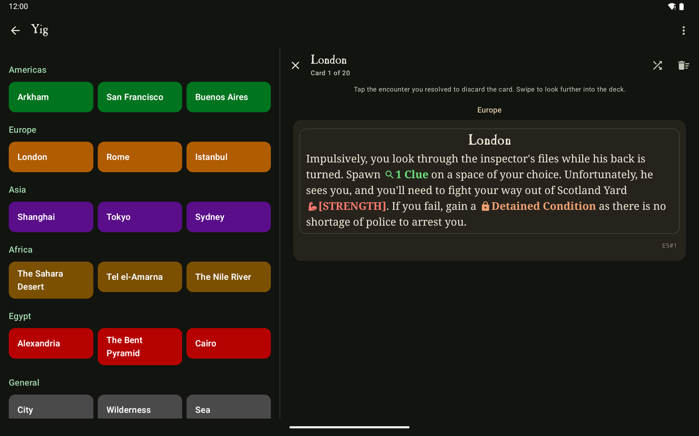
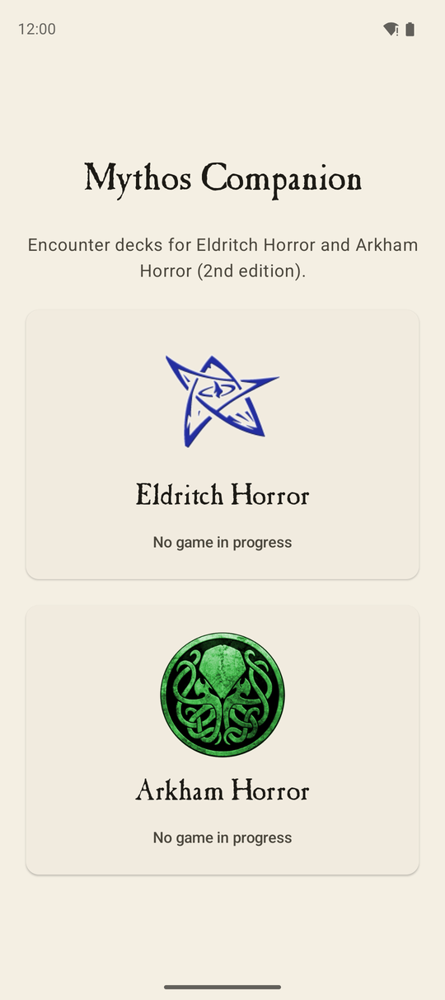
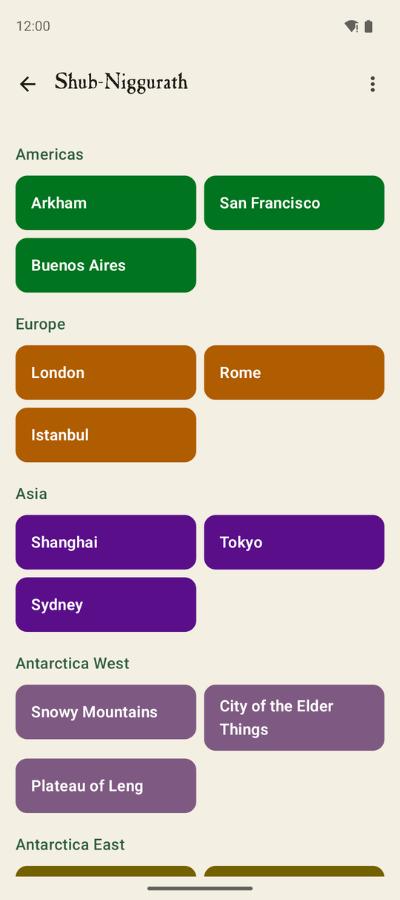
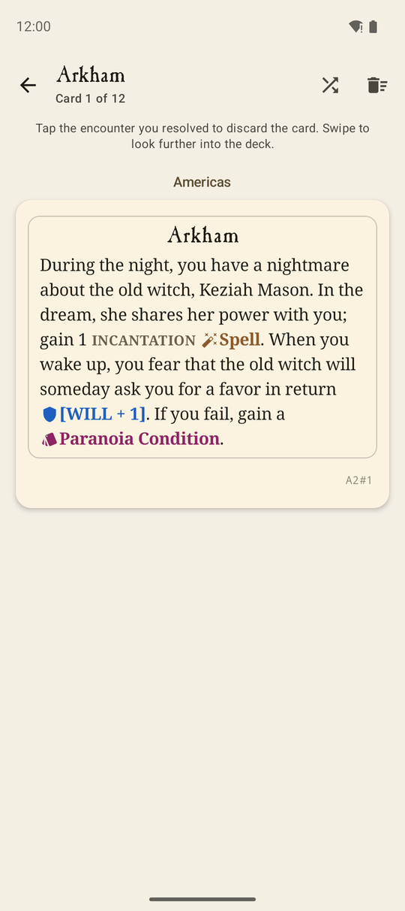
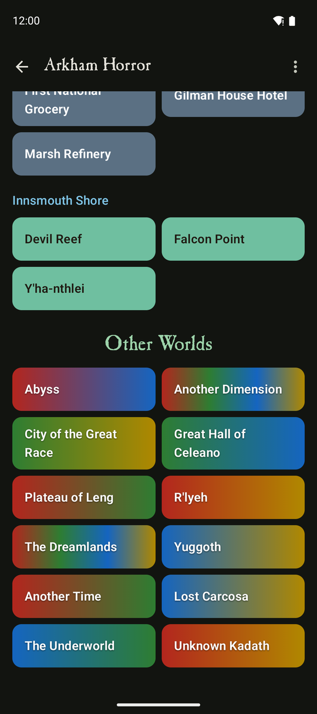
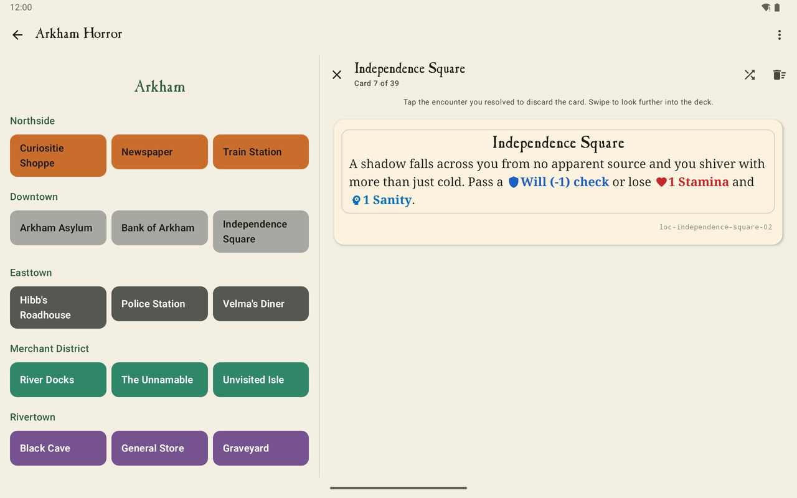
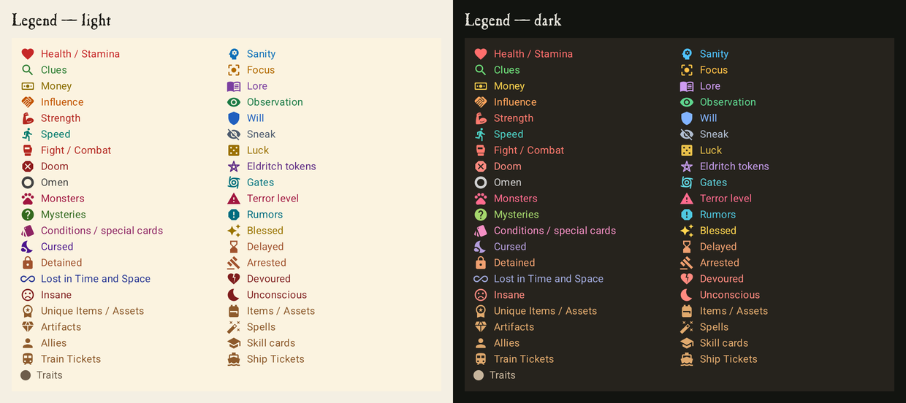

# Mythos Companion

An Android companion app for **Eldritch Horror** and **Arkham Horror (2nd edition)** that replaces the encounter decks on your phone or tablet. It is built for personal, sideloaded use.

- **Eldritch Horror** recreates the abandoned *Eldritch Companion* app (v8.0):
  - Expansions from Base through Masks of Nyarlathotep, including the side boards and the Cosmic Alignment and Litany of Secrets preludes.
  - Every encounter deck: regions, side boards, General, Gate, Expedition (with Remove), Mystic Ruins, Dream-Quest, Research, the Ancient One's Special decks, Disaster and Devastation.
  - As on the Arkham side, each location and space type has its own deck: Arkham, San Francisco and Buenos Aires instead of one Americas deck, and City, Wilderness and Sea for General and Research.
  - Swipe through a deck and tap the encounter you resolved to discard it. Browse the discard pile, with the parts of each card you didn't resolve shaded, and return cards to their decks.
- **Arkham Horror** replaces the 2012 *Arkham Encounters* app and works the same way as the Eldritch side.
  - **Decks:** every location and Other World has its own shuffled deck. All eight expansions are supported.
  - **Other World draws:** these keep the 2012 app's weighting between a world's own encounters and the "Other" gate encounters of matching colour, including the occasional "The Stars Are Right" reshuffle.
- **Saving:** each game saves automatically after every change, so you can leave mid-game and continue later, even if Android closes the app. The expansions you pick are remembered.
- **Screens and themes:** the app follows the system light and dark theme. It adapts from small phones to tablets: on wide screens the deck list and the open deck sit side by side.

## Screenshots



<table>
  <tr>
    <td></td>
    <td></td>
    <td></td>
    <td></td>
  </tr>
  <tr>
    <td align="center">Pick a game</td>
    <td align="center">Eldritch board: a deck per location</td>
    <td align="center">Encounter with highlighted terms</td>
    <td align="center">Arkham board in dark mode</td>
  </tr>
</table>



### Colour-coded card text

Game terms get a colour and an icon in both games. Eldritch skill tests use the investigator sheet colours.



## Download

Get the latest APK from [Releases](https://github.com/matthewslade/Mythos-Companion/releases/latest) and open it on your device. You'll need to allow installs from unknown sources. It needs Android 8.0 or newer.

## Building and installing

You need JDK 17 or newer and the Android SDK (compile SDK 37). Point `local.properties` at your SDK with `sdk.dir=/path/to/sdk`.

```sh
./gradlew assembleRelease          # app/build/outputs/apk/release/app-release.apk
adb install -r app/build/outputs/apk/release/app-release.apk
```

The release APK is minified and signed with the local debug key, so it installs directly on any device that allows installing apps from unknown sources. It needs Android 8.0 or newer.

## Tests

```sh
./gradlew testDebugUnitTest              # rules, deck engine, markup and card-data validation
./gradlew connectedDebugAndroidTest      # UI flows on a connected device or emulator
```

## Project layout

```
app/src/main/assets/            eldritch.json, arkham.json – all card data (see docs/DATA.md)
app/src/main/java/com/m42/companion/
  engine/                       DeckState: decks, discard pile, shuffle/refill rules shared by both games
  eldritch/                     Eldritch expansions, setup rules, deck building, board rules
  arkham/                       Arkham locations, Other World approximation
  store/                        GameStore: in-memory session mirrored to a JSON save file
  ui/                           Compose screens, theme, shared gallery and board components
```

`docs/DATA.md` describes the data format, the corrections made to the legacy Arkham data, and a short list of cards worth checking against the physical decks.
